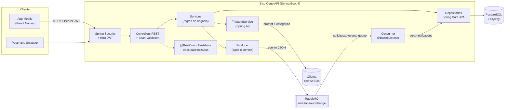
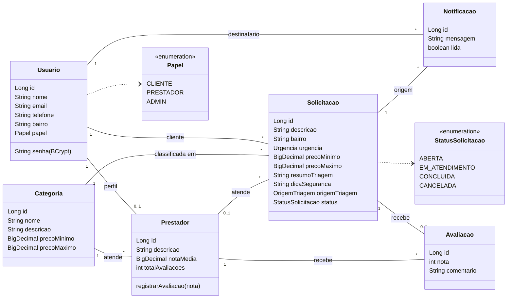
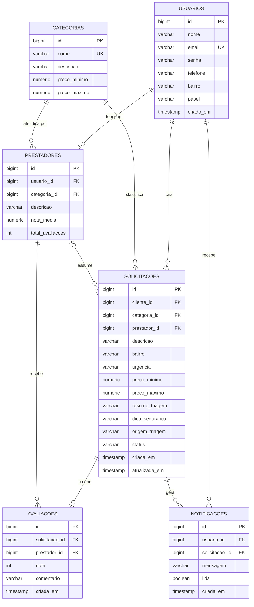
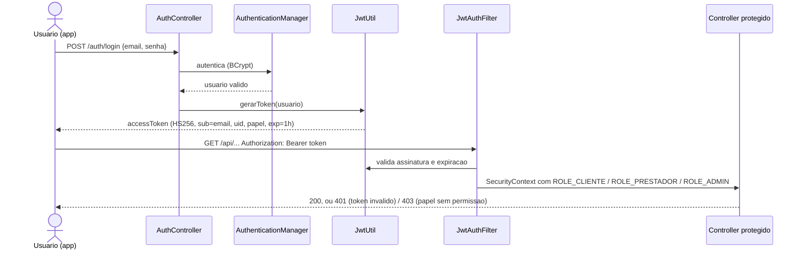
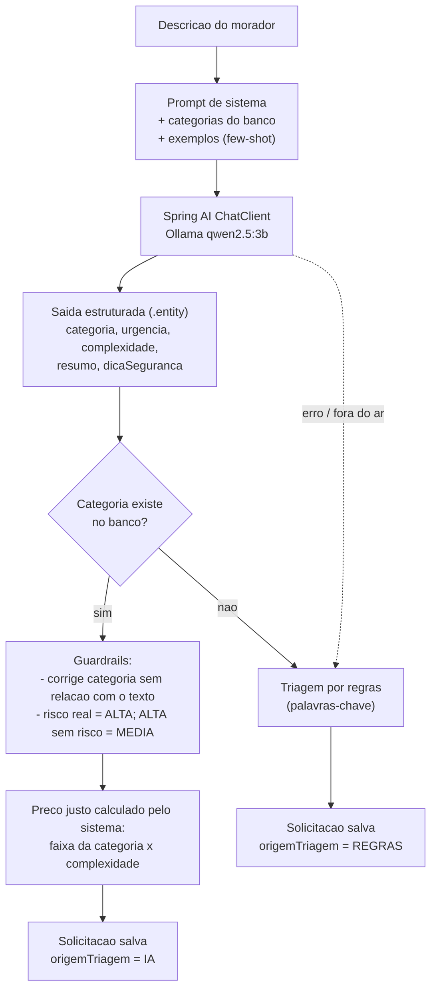
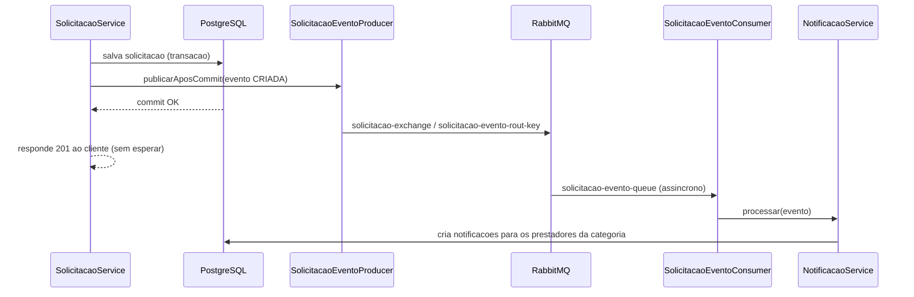

# Bico Certo API

> **Global Solution 2026/2 · CitizenTech · Java Advanced (FIAP)**
> Serviços do bairro com preço justo: o morador descreve o problema, a IA entende o que é, diz quanto é justo pagar e avisa os prestadores do bairro.

| | |
|---|---|
| **Repositório** | https://github.com/kaiky06301/bico-certo-java |
| **Vídeo pitch (até 5 min)** | `LINK_DO_VIDEO` |
| **Swagger (local)** | http://localhost:8080/swagger-ui.html |
| **Deploy** | Não há deploy desta API (roda localmente com Docker e Ollama) |
| **Arquitetura distribuída (requisito 5)** | **Opção A: RabbitMQ**, com evento publicado e consumido de forma assíncrona |

---

## Sumário
1. [O problema e a solução](#1-o-problema-e-a-solução)
2. [Funcionalidades](#2-funcionalidades)
3. [Arquitetura](#3-arquitetura)
4. [Modelagem: classes e banco de dados](#4-modelagem-classes-e-banco-de-dados)
5. [Segurança com JWT e papéis](#5-segurança-com-jwt-e-papéis)
6. [Triagem com Spring AI](#6-triagem-com-spring-ai)
7. [Mensageria com RabbitMQ](#7-mensageria-com-rabbitmq)
8. [Como rodar](#8-como-rodar)
9. [Usuários de teste](#9-usuários-de-teste)
10. [Endpoints principais](#10-endpoints-principais)
11. [Testes (JUnit + Postman)](#11-testes-junit--postman)
12. [Integração com o app Mobile](#12-integração-com-o-app-mobile)
13. [Tecnologias](#13-tecnologias)
14. [Declaração de uso de IA generativa](#14-declaração-de-uso-de-ia-generativa)
15. [Integrantes](#15-integrantes)

---

## 1. O problema e a solução

**Quem é o cidadão:** moradores de bairros periféricos que precisam de um eletricista, encanador ou diarista, e os prestadores informais desses mesmos bairros.

**O problema:** quem precisa de um serviço depende de indicação e **não sabe quanto é justo pagar**. Muitas vezes também não sabe se o problema é perigoso (uma tomada soltando faísca, por exemplo). Do outro lado, o prestador bom do bairro não consegue clientes fora do seu círculo e não tem como provar a sua reputação.

**A solução:** o **Bico Certo** é a API (backend) da plataforma:
1. O morador descreve o problema com as próprias palavras.
2. A **triagem com Spring AI** identifica a categoria do serviço, a urgência e uma **faixa de preço justo**, e ainda dá uma **dica de segurança** para o morador seguir enquanto espera.
3. O pedido é publicado no **RabbitMQ** e os prestadores daquela categoria recebem uma notificação, com prioridade para quem é do mesmo bairro.
4. O prestador assume e conclui o serviço, e o cliente o avalia. A **reputação** do prestador é calculada a partir dessas avaliações.

**ODS atendidos:** **10** (redução das desigualdades): dá acesso a informação de preço e a trabalho para quem está na informalidade. **11** (cidades e comunidades sustentáveis): fortalece a economia e as redes de confiança do próprio bairro.

**Funciona fora do cenário ideal:** se o modelo de IA estiver fora do ar, a triagem por regras (palavras-chave) assume e o app continua funcionando. Se o RabbitMQ cair, o pedido é salvo normalmente e só as notificações deixam de ser geradas.

---

## 2. Funcionalidades

| Papel | O que pode fazer |
|---|---|
| **CLIENTE** | Simular a triagem, criar, editar e cancelar pedidos, acompanhar os seus pedidos, avaliar o prestador e ver as notificações |
| **PRESTADOR** | Ver os pedidos abertos da sua categoria, assumir, concluir, editar o perfil e ver as notificações |
| **ADMIN** | Manter a tabela de categorias e preços de referência (CRUD), listar todos os pedidos e os usuários |

**Regras de negócio principais**
- Só o prestador **da categoria do pedido** pode assumi-lo, e um pedido só pode ser assumido **uma vez**: a linha é travada no banco (`PESSIMISTIC_WRITE`) para evitar que dois prestadores assumam ao mesmo tempo.
- O **telefone** do cliente e do prestador só aparece **depois** que o pedido é assumido (proteção de dados pessoais).
- Só é possível avaliar um pedido **CONCLUÍDO**, uma única vez. A nota média do prestador é recalculada a cada avaliação.
- Excluir um pedido é uma **exclusão lógica**: o status vira `CANCELADA` e o histórico é mantido.
- O **preço justo nunca vem direto do modelo de IA**: ele é calculado pelo sistema sobre a faixa de referência da categoria.

---

## 3. Arquitetura



**Camadas:** `controller` (REST e validação) → `service` (regras de negócio) → `repository` (JPA). As pastas `security` (JWT), `messaging` (RabbitMQ), `exception` (erros) e `config` completam a estrutura.

---

## 4. Modelagem: classes e banco de dados

São **6 entidades relacionadas** (o requisito pede no mínimo 3).

### Diagrama de classes



### Diagrama ER (banco PostgreSQL, versionado com Flyway)



As migrations ficam em `src/main/resources/db/migration`: a `V1__Create_tables.sql` cria as tabelas e a `V2__Insert_categorias.sql` carrega a **tabela de referência de preços**.

---

## 5. Segurança com JWT e papéis



- Sessão **stateless**, com o token assinado em HS256 pela biblioteca `jjwt` (mesma abordagem da Aula 13). O segredo vem da variável de ambiente `JWT_SECRET` (mínimo de 32 caracteres) e **nunca fica no código**.
- **3 papéis** (o requisito pede no mínimo 2): `CLIENTE`, `PRESTADOR` e `ADMIN`. As permissões são aplicadas em duas camadas: rotas no `SecurityConfig` e `@PreAuthorize` em cada endpoint.
- Os erros 401 e 403 também saem no formato padrão `ErroResponse`.
- As senhas são gravadas com **BCrypt**. O cadastro público não permite criar ADMIN.

---

## 6. Triagem com Spring AI

A IA **faz parte do fluxo principal**: ela é chamada toda vez que um pedido é criado ou editado, e o seu resultado é gravado na solicitação. Não é um chat solto.



- **Contexto vindo do banco:** a lista de categorias enviada ao modelo é lida da tabela `categorias`. Se o ADMIN criar uma categoria nova, a IA passa a considerá-la sem precisar mudar código.
- **Saída estruturada:** `chatClient.prompt()...call().entity(TriagemIa.class)` converte o JSON do modelo direto para um `record` Java.
- **Preço justo:** o modelo classifica a **complexidade** (SIMPLES, MEDIA ou COMPLEXA) e o sistema calcula a faixa de preço dentro da faixa de referência da categoria. Assim o valor nunca sai do intervalo de referência.
- **Prompt:** fica em `src/main/resources/prompts/triagem.st`.

Exemplo real (Ollama local):
```json
POST /api/solicitacoes/triagem
{ "descricao": "A tomada da cozinha esta soltando faisca quando ligo a geladeira e tem cheiro de queimado" }

200 OK
{
  "categoria": { "id": 1, "nome": "Eletrica" },
  "urgencia": "ALTA",
  "precoMinimo": 80.00,
  "precoMaximo": 190.00,
  "resumo": "Tomada da cozinha soltando faisca quando ligar a geladeira",
  "dicaSeguranca": "Desligue o disjuntor da cozinha e nao use a tomada ate que o eletricista chegue",
  "origem": "IA",
  "prestadoresDisponiveis": 1
}
```

Nos testes manuais com 8 descrições diferentes (elétrica, encanamento, montagem, limpeza, pintura e pequenos reparos), a triagem acertou a categoria nos 8 casos.

---

## 7. Mensageria com RabbitMQ

**Opção escolhida no requisito 5: A) RabbitMQ**, com evento publicado e consumido de forma assíncrona.



| Evento | Quem é notificado |
|---|---|
| `CRIADA` | Prestadores da categoria do pedido, com destaque para os do mesmo bairro |
| `ASSUMIDA` | Cliente: "Fulano vai atender o seu pedido" |
| `CONCLUIDA` | Cliente: pedido para avaliar o prestador |
| `CANCELADA` | Prestador que tinha assumido o pedido |

- O evento só é publicado **depois do commit** (`TransactionSynchronization.afterCommit`), então o consumidor nunca lê uma solicitação que ainda não existe no banco.
- O padrão de nomes (exchange, queue e rout-key) segue o que foi usado em aula. O painel do RabbitMQ fica em http://localhost:15672 (usuário `guest`, senha `guest`).

---

## 8. Como rodar

**Pré-requisitos:** Java 21, Docker (com Docker Compose) e [Ollama](https://ollama.com).

```bash
# 1. Clonar o repositorio
git clone https://github.com/kaiky06301/bico-certo-java.git
cd bico-certo-java

# 2. Criar o arquivo de variaveis de ambiente (o .env nao vai para o Git)
cp .env.example .env
#    edite o .env: defina DB_PASSWORD e um JWT_SECRET com 32+ caracteres

# 3. Subir PostgreSQL e RabbitMQ
docker compose --env-file .env up -d

# 4. Baixar o modelo de IA local (uma vez so, ~1,9 GB)
ollama pull qwen2.5:3b

# 5. Rodar a API (o Flyway cria as tabelas e o DataLoader cria os usuarios de teste)
./mvnw spring-boot:run
```

Acesse o Swagger em **http://localhost:8080/swagger-ui.html**: faça login em `POST /auth/login`, copie o `accessToken` e clique em **Authorize**.

> Se já houver um RabbitMQ rodando na porta 5672, suba só o banco com `docker compose --env-file .env up -d postgres` e a API usa o RabbitMQ existente.

**Variáveis de ambiente** (todas estão no `.env.example`):

| Variável | Para que serve |
|---|---|
| `DB_URL`, `DB_USERNAME`, `DB_PASSWORD` | Conexão com o PostgreSQL |
| `JWT_SECRET`, `JWT_EXPIRATION_MS` | Assinatura e validade do token |
| `RABBITMQ_HOST`, `RABBITMQ_PORT`, `RABBITMQ_USERNAME`, `RABBITMQ_PASSWORD` | Broker de mensagens |
| `OLLAMA_BASE_URL`, `OLLAMA_MODEL` | Modelo de IA local |
| `SEED_PASSWORD` | Senha dos usuários de teste criados na primeira execução |

---

## 9. Usuários de teste

São criados automaticamente na primeira execução, com a senha definida em `SEED_PASSWORD` (`senha123` no `.env.example`).

| Papel | E-mail | Bairro | Observação |
|---|---|---|---|
| ADMIN | `admin@bicocerto.com.br` | Centro | Mantém as categorias |
| CLIENTE | `maria@bicocerto.com.br` | Capão Redondo | |
| CLIENTE | `pedro@bicocerto.com.br` | Jardim Ângela | |
| PRESTADOR | `joao@bicocerto.com.br` | Capão Redondo | Elétrica |
| PRESTADOR | `carlos@bicocerto.com.br` | Capão Redondo | Encanamento |
| PRESTADOR | `ana@bicocerto.com.br` | Jardim Ângela | Limpeza |

---

## 10. Endpoints principais

Todos usam `Authorization: Bearer <token>`, exceto login e cadastro. As listagens são **paginadas** (`?page=0&size=10&sort=campo,desc`) e devolvem `{ conteudo, pagina, tamanho, totalElementos, totalPaginas }`.

| Método | Rota | Papel | Descrição |
|---|---|---|---|
| POST | `/auth/registrar` | público | Cadastro de CLIENTE ou PRESTADOR |
| POST | `/auth/login` | público | Devolve o JWT |
| GET | `/auth/me` | logado | Dados do usuário logado |
| GET | `/api/categorias` | logado | Lista categorias (paginado) |
| POST / PUT / DELETE | `/api/categorias/{id}` | ADMIN | CRUD da tabela de referência |
| POST | `/api/solicitacoes/triagem` | CLIENTE | Prévia da triagem com IA |
| POST | `/api/solicitacoes` | CLIENTE | Cria o pedido (IA + evento RabbitMQ) |
| GET | `/api/solicitacoes/minhas` | CLIENTE | Pedidos do cliente |
| PUT | `/api/solicitacoes/{id}` | CLIENTE | Edita um pedido ABERTO (refaz a triagem) |
| DELETE | `/api/solicitacoes/{id}` | CLIENTE | Cancela o pedido (exclusão lógica) |
| POST | `/api/solicitacoes/{id}/avaliacao` | CLIENTE | Avalia o prestador (1 a 5) |
| GET | `/api/solicitacoes/abertas` | PRESTADOR | Pedidos abertos da sua categoria |
| GET | `/api/solicitacoes/atendimentos` | PRESTADOR | Pedidos que assumiu |
| PATCH | `/api/solicitacoes/{id}/assumir` | PRESTADOR | Assume o pedido |
| PATCH | `/api/solicitacoes/{id}/concluir` | PRESTADOR | Conclui o serviço |
| GET | `/api/solicitacoes?status=` | ADMIN | Todos os pedidos |
| GET | `/api/solicitacoes/{id}` | dono, prestador ou ADMIN | Detalhe do pedido |
| GET | `/api/prestadores?categoriaId=&bairro=` | logado | Prestadores ordenados pela nota |
| GET | `/api/prestadores/{id}/avaliacoes` | logado | Avaliações recebidas |
| GET / PUT | `/api/prestadores/me` | PRESTADOR | Perfil do prestador |
| GET | `/api/notificacoes` | logado | Notificações (geradas pelo consumer) |
| PATCH | `/api/notificacoes/{id}/lida` | logado | Marca como lida |
| GET | `/api/usuarios` | ADMIN | Lista usuários |

### Formato padrão de erro (`@RestControllerAdvice`)

```json
{
  "timestamp": "2026-11-13T00:29:16",
  "status": 400,
  "erro": "Dados invalidos",
  "mensagem": "Um ou mais campos estao invalidos",
  "caminho": "/api/categorias",
  "campos": [ { "campo": "nome", "mensagem": "Informe o nome" } ]
}
```

| Status | Quando |
|---|---|
| 400 | Bean Validation, JSON inválido ou parâmetro inválido |
| 401 | Login inválido ou token ausente, expirado ou adulterado |
| 403 | O papel não tem permissão, ou o recurso é de outro usuário |
| 404 | Recurso ou rota inexistente |
| 409 | Conflito de integridade no banco |
| 422 | Regra de negócio (ex.: avaliar um pedido não concluído, assumir um pedido já assumido) |

### Exemplos com cURL

```bash
# login (guarde o accessToken)
curl -X POST http://localhost:8080/auth/login -H "Content-Type: application/json" \
  -d '{"email":"maria@bicocerto.com.br","senha":"senha123"}'

# criar pedido (cliente)
curl -X POST http://localhost:8080/api/solicitacoes -H "Authorization: Bearer TOKEN_CLIENTE" \
  -H "Content-Type: application/json" -d '{"descricao":"O interruptor do quarto esta dando choque quando encosto"}'

# pedidos abertos e assumir (prestador)
curl http://localhost:8080/api/solicitacoes/abertas -H "Authorization: Bearer TOKEN_PRESTADOR"
curl -X PATCH http://localhost:8080/api/solicitacoes/1/assumir -H "Authorization: Bearer TOKEN_PRESTADOR"
```

---

## 11. Testes (JUnit + Postman)

### Automatizados (JUnit 5, 18 testes)

```bash
./mvnw test
```
Os testes rodam em **H2**, com as **mesmas migrations do Flyway**. O modelo de IA e o RabbitMQ são simulados, então não é preciso ter Ollama nem broker rodando.

| Classe | O que cobre |
|---|---|
| `TriagemServiceTest` (9) | Normalização da resposta da IA, guardrails de categoria e urgência, cálculo do preço justo e triagem por regras |
| `PrestadorTest` (1) | Cálculo da nota média |
| `FluxoSolicitacaoIntegracaoTest` (8) | Login 401, rota sem token, 403 por papel, validação 400, paginação, fluxo completo (criar → evento RabbitMQ → assumir → concluir → avaliar), privacidade e IA fora do ar |

### Postman

A coleção `postman/Bico-Certo-API.postman_collection.json` tem **33 requisições com 45 asserções** e roda em ordem com o Runner. Os tokens são salvos automaticamente em variáveis. Também pode ser rodada pelo terminal, com a API no ar:

```bash
npx newman run postman/Bico-Certo-API.postman_collection.json --delay-request 300
```

Resultado da última execução: **33 requisições, 45 asserções, 0 falhas**.

---

## 12. Integração com o app Mobile

O app em React Native (disciplina de Mobile) consome esta API:
- **CORS liberado** para o app (Expo web e dispositivo).
- Fluxo do app: login → `POST /api/solicitacoes/triagem` (tela de prévia: "isso parece um serviço de elétrica, urgência ALTA, preço justo de R$ 80 a R$ 190") → `POST /api/solicitacoes` → acompanhamento em `GET /api/solicitacoes/minhas` → avaliação.
- Para o prestador: `GET /api/solicitacoes/abertas`, `PATCH .../assumir` e `PATCH .../concluir`, mais o badge de `GET /api/notificacoes/nao-lidas`.
- Rodando no celular pelo Expo Go, use o IP do computador na rede (ex.: `http://192.168.0.10:8080`) em vez de `localhost`.

---

## 13. Tecnologias

| Tecnologia | Uso |
|---|---|
| Java 21 + Spring Boot 4.1 | Base da API |
| Spring Data JPA + PostgreSQL 16 | Persistência e paginação |
| Flyway | Versionamento do banco |
| Spring Security + jjwt 0.11.5 | Autenticação JWT e papéis |
| Bean Validation + `@RestControllerAdvice` | Validação e erros padronizados |
| Spring AI 2.0 + Ollama (qwen2.5:3b) | Triagem com IA generativa local |
| Spring AMQP + RabbitMQ 3.13 | Mensageria assíncrona |
| springdoc-openapi 3 | Swagger / OpenAPI |
| JUnit 5, MockMvc, H2, Postman/Newman | Testes |
| Docker Compose | Banco e broker locais |

---

## 14. Declaração de uso de IA generativa

Conforme as regras da Global Solution:

| Ferramenta | Para quê |
|---|---|
| `FERRAMENTA_1` | Apoio na pesquisa de bibliotecas e na explicação de erros de compilação e configuração |
| `FERRAMENTA_2` | Revisão de texto da documentação |

Todo o código foi revisado, testado e entendido pelo grupo antes da entrega. **No produto**, a IA generativa é usada na **triagem das solicitações** (seção 6), com um modelo local (Ollama) e guardrails que validam cada resposta.

---

## 15. Integrantes

| Nome | RM | Turma |
|---|---|---|
| `NOME_1` | `RM_1` | `TURMA` |
| `NOME_2` | `RM_2` | `TURMA` |
| `NOME_3` | `RM_3` | `TURMA` |
| `NOME_4` | `RM_4` | `TURMA` |
| `NOME_5` | `RM_5` | `TURMA` |
